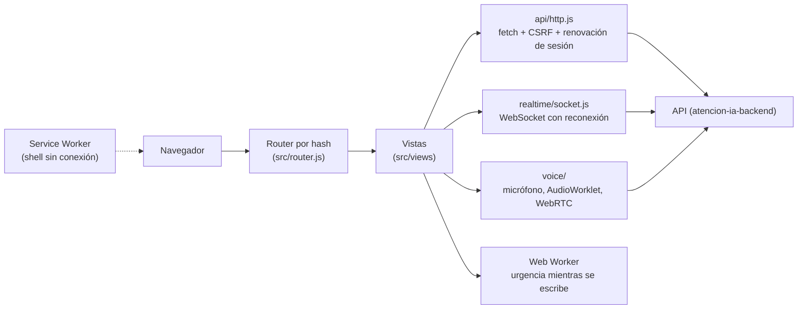

# atencion-ia-frontend: la aplicación web de Atención IA

**Producción:** <https://atencion.jonarproyectos.com>

Este repositorio es la parte visible de **Atención IA**: el widget del cliente, el panel de los
asesores y la administración. La **guía completa para evaluar el proyecto** (acceso, roles y la
prueba de cada función paso a paso) está en el README principal, en
[atencion-ia-backend](https://github.com/Jonar519/atencion-ia-backend#readme). Aquí se explica lo
propio del frontend.

## Contenido

1. [Qué es](#1-qué-es)
2. [Cómo funciona](#2-cómo-funciona)
3. [Tecnologías](#3-tecnologías)
4. [Qué se necesita](#4-qué-se-necesita)
5. [Acceso y roles](#5-acceso-y-roles)
6. [Guía de pruebas](#6-guía-de-pruebas)
7. [Pruebas automatizadas](#7-pruebas-automatizadas)
8. [Limitaciones y decisiones de diseño](#8-limitaciones-y-decisiones-de-diseño)
9. [Solución de problemas](#9-solución-de-problemas)
10. [Estructura del repositorio](#10-estructura-del-repositorio)
11. [Glosario](#11-glosario)

## 1. Qué es

Una aplicación de una sola página (SPA) escrita en **JavaScript sin framework**, que habla con la API
de [atencion-ia-backend](https://github.com/Jonar519/atencion-ia-backend). Tiene tres superficies:

- **Widget del cliente** (`#/chat`): chat de texto y llamada de voz con el asistente de IA, adjuntos
  y, si el caso escala, la conversación con un asesor en tiempo real.
- **Panel de asesores** (`#/agente`): cola priorizada que se actualiza sola, historial antes de tomar
  el caso, respuestas, adjuntos, cierre, unión a llamadas por WebRTC y perfil de la cuenta.
- **Administración** (`#/admin/...`, solo administradores): base de conocimiento, respuestas
  predefinidas, equipo e invitaciones, y analítica con gráficos.

## 2. Cómo funciona

La app es un conjunto de archivos estáticos (HTML, CSS y JavaScript) que Vercel sirve. Todo dato
viene de la API (`VITE_API_URL`) por `fetch`, y los cambios en vivo llegan por WebSocket. Un
**router por hash** decide qué pantalla mostrar según lo que va después de `#` en la dirección:

| Ruta                                                                         | Pantalla                                                              | Quién                      |
| ---------------------------------------------------------------------------- | --------------------------------------------------------------------- | -------------------------- |
| `#/`                                                                         | Portada                                                               | Cualquiera                 |
| `#/chat`                                                                     | Widget del cliente (chat y llamada)                                   | Cualquiera (sin cuenta)    |
| `#/agente/login`                                                             | Inicio de sesión del equipo                                           | Cualquiera                 |
| `#/agente/recuperar` · `#/agente/restablecer`                                | Pedir y usar el enlace para cambiar la contraseña                     | Cualquiera (con el enlace) |
| `#/agente/confirmar-correo`                                                  | Confirmar un cambio de correo                                         | Con el enlace del correo   |
| `#/agente/invitacion`                                                        | Completar una cuenta invitada                                         | Con el enlace del correo   |
| `#/agente`                                                                   | Panel: cola, mis casos, conversación y llamada                        | Asesor y administrador     |
| `#/agente/perfil`                                                            | Mi perfil (datos, foto, correo, contraseña, MFA, sesiones, mis datos) | Asesor y administrador     |
| `#/admin/kb` · `#/admin/respuestas` · `#/admin/equipo` · `#/admin/analytics` | Administración                                                        | Solo administrador         |



Puntos clave (detalle en [docs/referencia-tecnica.md](docs/referencia-tecnica.md)):

- **Sesión del asesor:** el token de acceso vive solo en memoria; al recargar se renueva con una
  cookie httpOnly. Cerrar sesión en una pestaña la cierra en las demás.
- **Sesión del cliente:** una cookie httpOnly que el JavaScript no puede leer.
- **Tiempo real solo de recepción:** se envía por REST (sin duplicados, gracias a un id por mensaje)
  y se recibe por WebSocket; al reconectar, se vuelve a pedir el historial.
- **XSS:** todo texto entra al DOM como nodo de texto; ESLint prohíbe `innerHTML`.
- **Voz:** el micrófono se pide antes de crear la llamada, se envía audio de 16 kHz en tramas de
  100 ms y el micrófono se apaga siempre al terminar.

## 3. Tecnologías

Versiones del `package.json` (rangos declarados):

| Tecnología                                                            | Versión            | Para qué se usa                                                                              | Por qué se eligió                                                       |
| --------------------------------------------------------------------- | ------------------ | -------------------------------------------------------------------------------------------- | ----------------------------------------------------------------------- |
| **JavaScript** (módulos ES), HTML y CSS                               | —                  | Toda la app, sin framework                                                                   | El curso evalúa DOM, eventos y asincronía de forma directa.             |
| **Vite**                                                              | ^7.3.7             | Servidor de desarrollo y build de producción                                                 | Arranque rápido y build con nombres con hash para la caché.             |
| **Web Workers**, **AudioWorklet**, **WebRTC**, **Canvas 2D**, **SVG** | APIs del navegador | Urgencia en segundo plano, captura de audio, llamada con el asesor, forma de onda y gráficos | APIs nativas, sin dependencias.                                         |
| **Service Worker**                                                    | API del navegador  | Carga sin conexión del shell (nunca la API)                                                  | La app abre aunque falle la red, sin guardar datos personales.          |
| **@fontsource** (Inter, Source Serif 4)                               | ^5.3.0             | Tipografías servidas desde la propia app                                                     | Sin pedir fuentes a terceros (lo exige la CSP).                         |
| **Vitest** + **jsdom**                                                | ^4.1.12 · ^29.1.1  | Tests unitarios y de componentes                                                             | Mismo motor de pruebas que el backend.                                  |
| **Playwright** + **axe**                                              | ^1.63.0 · ^4.13.0  | E2E en Chromium contra el sistema completo y accesibilidad                                   | Prueba el flujo real, incluida la voz con un micrófono simulado.        |
| **ESLint** · **Prettier**                                             | ^10.11.0 · ^3.9.9  | Reglas y formato                                                                             | Prohíben `innerHTML` y otras puertas de XSS.                            |
| **Vercel**                                                            | —                  | Hospeda los archivos estáticos con HTTPS y cabeceras de seguridad                            | Despliegue desde `main`; configuración en [`vercel.json`](vercel.json). |
| **GitHub Actions** · **gitleaks**                                     | gitleaks `v8.21.2` | CI: lint, tests, mutaciones, build, E2E, `npm audit` y secretos                              | Nada llega a `main` sin pasar las pruebas.                              |

## 4. Qué se necesita

- **Para evaluarlo en producción:** solo un navegador actualizado (Chrome, Edge o Firefox) y, para
  la voz, micrófono y altavoces. Ver
  [Qué necesita el profesor](https://github.com/Jonar519/atencion-ia-backend#4-qué-necesita-el-profesor).
- **Para correrlo en local:** Node.js 20 o superior (la CI usa 24) y la API corriendo en
  `http://localhost:4100` (base de datos y backend:
  [opción local](https://github.com/Jonar519/atencion-ia-backend#b-opción-local-opcional)). Luego:

```bat
cd atencion-ia-frontend
npm install
npm run dev
```

Esperado: `Local: http://localhost:5174/`. Ábrelo y verás la portada. La app usa la API de
`VITE_API_URL` (por defecto `http://localhost:4100`); si la API está en otro puerto,
`copy .env.example .env` y cambia ese valor (solo el origen, sin ruta), por ejemplo:

```ini
VITE_API_URL=http://localhost:4100
```

Para probar el build con el Service Worker y la CSP reales: `npm run build` y `npm run preview`
(puerto 4174; la API debe tener `http://localhost:4174` en `CORS_ORIGIN`).

## 5. Acceso y roles

El cliente entra sin cuenta (**Soy cliente → Iniciar chat**). Asesores y administradores entran con
correo y contraseña; las cuentas solo se crean por invitación y el administrador debe usar
verificación en dos pasos. Las credenciales las entrega el estudiante por un canal privado. Todo el
detalle (roles, invitaciones de 72 horas, MFA, qué hacer si falla):
[Acceso y roles](https://github.com/Jonar519/atencion-ia-backend#5-acceso-y-roles).

## 6. Guía de pruebas

La guía función por función, con pasos y resultado esperado, está en el README principal:
[Guía de pruebas](https://github.com/Jonar519/atencion-ia-backend#6-guía-de-pruebas-función-por-función).
Qué pantallas de este repositorio cubre cada bloque:

| Bloque de la guía                  | Pantallas                                                                                        |
| ---------------------------------- | ------------------------------------------------------------------------------------------------ |
| A. Portada y apariencia            | `#/` y el tema del sistema en todas                                                              |
| B. El cliente y el asistente de IA | `#/chat`                                                                                         |
| C. Panel del asesor y tiempo real  | `#/agente`                                                                                       |
| D. Llamada de voz                  | `#/chat` (barra de llamada) y `#/agente` (Unirse a la llamada)                                   |
| E. Cuenta del asesor               | `#/agente/perfil`, `#/agente/recuperar`, `#/agente/restablecer`, `#/agente/confirmar-correo`     |
| F. Administración                  | `#/admin/kb`, `#/admin/respuestas`, `#/admin/equipo`, `#/admin/analytics`, `#/agente/invitacion` |
| G. Robustez y seguridad            | Avisos de conexión, Service Worker, almacenamiento del navegador                                 |

## 7. Pruebas automatizadas

| Comando                  | Qué cubre                                                                                                                                                                        | Resultado esperado                               |
| ------------------------ | -------------------------------------------------------------------------------------------------------------------------------------------------------------------------------- | ------------------------------------------------ |
| `npm test`               | Render seguro (XSS), sesión, WebSocket con reconexión, chat, panel, voz, Service Worker, administración, estados de la interfaz y contraste WCAG medido sobre los colores reales | `Tests 416 passed (416)` en 24 archivos.         |
| `npm run test:mutations` | Rompe a propósito 124 reglas críticas (token en `sessionStorage`, texto como HTML, micrófono que no se apaga…) y exige que algún test falle                                      | `124/124 mutaciones detectadas.`                 |
| `npm run lint`           | ESLint y Prettier                                                                                                                                                                | Sin errores.                                     |
| `scripts\verify.bat`     | lint → tests → build, en ese orden                                                                                                                                               | Termina sin errores.                             |
| `scripts\e2e.bat`        | Seis escenarios de Playwright en un entorno aislado: texto, voz con WebRTC, adjuntos, invitación, tema del sistema y API en otro origen (con axe y sin violaciones de CSP)       | Todos en verde ([e2e/README.md](e2e/README.md)). |

Los tests de `npm test` no necesitan el backend: simulan `fetch` y el WebSocket. El E2E sí levanta
todo (base de datos, API, worker y frontend) en puertos aparte. La CI corre todo en cada `push`.

## 8. Limitaciones y decisiones de diseño

- **Sin framework y sin selector de tema:** a propósito. El tema claro u oscuro lo decide el sistema
  operativo, en CSS.
- **Almacenamiento mínimo en el navegador:** ningún token ni conversación en `localStorage`; solo el
  shell de la app en la caché del Service Worker.
- **El aviso de urgencia no decide nada:** el Web Worker solo muestra un aviso; el servidor clasifica
  cada mensaje y aplica sus reglas.
- **Voz entre redes distintas:** sin servidor TURN configurado, el audio directo entre cliente y
  asesor solo conecta en el mismo equipo o red (ver las
  [limitaciones del proyecto](https://github.com/Jonar519/atencion-ia-backend#8-limitaciones-conocidas-y-decisiones-de-diseño)).
- **Navegadores:** probado de forma automática en Chromium (Playwright); Chrome, Edge y Firefox de
  escritorio actualizados son los recomendados.

## 9. Solución de problemas

| Síntoma                                               | Qué hacer                                                                                                                                   |
| ----------------------------------------------------- | ------------------------------------------------------------------------------------------------------------------------------------------- |
| "Desconectado" o "Reconectando…" que no se va         | La API no responde o la red bloquea WebSockets. En local, revisa que la API corra en `VITE_API_URL`.                                        |
| La app muestra una versión vieja después de un cambio | El Service Worker sirve el shell anterior: recarga con Ctrl+F5 o cierra y abre la pestaña.                                                  |
| Local: errores de CORS en la consola                  | El origen de la app no está en `CORS_ORIGIN` del backend (`http://localhost:5174`; para `npm run preview`, agrega `http://localhost:4174`). |
| El build de Vercel falla por `VITE_API_URL`           | En Vercel la variable es obligatoria y debe ser `https://` (sin ruta). En local, el build usa `http://localhost:4100` si no la defines.     |
| No se puede llamar: permiso del micrófono             | Candado de la barra de direcciones → **Micrófono → Permitir** y recarga.                                                                    |

Más síntomas del proyecto completo:
[Solución de problemas](https://github.com/Jonar519/atencion-ia-backend#9-solución-de-problemas).

## 10. Estructura del repositorio

```
atencion-ia-frontend/
├── index.html · public/        # documento base, página sin conexión y favicon
├── src/
│   ├── main.js · app.js        # arranque y registro de rutas
│   ├── router.js               # router por hash con guardas por rol
│   ├── auth/                   # sesión del asesor (token en memoria, renovación)
│   ├── api/                    # fetch con CSRF y los endpoints del widget, el panel y la administración
│   ├── realtime/               # WebSocket con reconexión y resincronización
│   ├── chat/                   # almacén de mensajes sin duplicados
│   ├── voice/                  # micrófono, AudioWorklet, reproducción, WebRTC y sesión de voz
│   ├── urgency/ · workers/     # clasificador local de urgencia y su Web Worker
│   ├── sw/                     # Service Worker y su estrategia de caché
│   ├── views/                  # pantallas: portada, chat, login, panel, perfil, recuperación, invitación, admin
│   ├── components/             # piezas reutilizables: estados, conectividad, forma de onda, gráficos, adjuntos, menú
│   ├── lib/                    # utilidades: creación segura de nodos (dom.js), adjuntos, prioridad
│   └── styles/                 # sistema de diseño (tokens.css) y estilos por pantalla
├── tests/                      # Vitest + jsdom
├── e2e/                        # Playwright
├── scripts/                    # verify, e2e, build del Service Worker, CSP, mutaciones
├── docs/                       # referencia técnica, sistema de diseño, prueba de voz
├── vite.config.js · vercel.json
└── package.json
```

## 11. Glosario

| Término             | Qué significa aquí                                                                                          |
| ------------------- | ----------------------------------------------------------------------------------------------------------- |
| **SPA**             | Aplicación de una sola página: el navegador carga una vez y cambia de pantalla sin recargar.                |
| **Router por hash** | Elige la pantalla según lo que va después de `#` en la dirección (`#/chat`, `#/agente`).                    |
| **CSP**             | _Content Security Policy_: cabecera que limita de dónde puede cargar scripts y a qué servidores conectarse. |
| **CORS**            | Reglas con las que la API acepta peticiones de la app, que está en otro origen.                             |
| **AudioWorklet**    | Hilo de audio del navegador; aquí convierte el micrófono en tramas de 16 kHz.                               |
| **WCAG**            | Pautas de accesibilidad; los tests miden el contraste de los colores contra ellas.                          |

El glosario completo (RAG, WebSocket, WebRTC, MFA…) está en el
[README principal](https://github.com/Jonar519/atencion-ia-backend#11-glosario).
